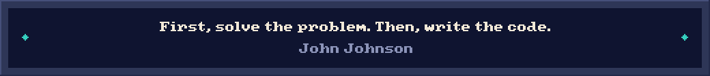

<picture>
  <source media="(max-width: 600px)" srcset="./assets/header-mobile.svg">
  
</picture>

 

  
  &nbsp;
  
  &nbsp;
  
  &nbsp;
  

 

The systems behind the interface.

I'm Samet, a backend developer and system architect based in Türkiye. I work on scalable microservices, cloud architecture, and the data layer that holds everything together.

I care about clear boundaries, maintainable code, and understanding what happens after a service reaches production. My approach to debugging? Treat the logs like evidence.

 

01   /   Where I focus

Area

What I care about

Backend engineering

Clear APIs, service boundaries, and business logic that stays understandable.

Data & performance

Query optimization, intentional caching, and reliable data flows.

Cloud & delivery

Containerized services, repeatable deployments, and observable systems.

 

02   /   My toolkit

  
  
  
  
   
  
  
  
  

<b>Explore the full toolkit</b>

 

Layer

Technologies

Backend & languages

PHP · Laravel · Node.js · NestJS · TypeScript · Python · Go

Data & messaging

MySQL · PostgreSQL · MongoDB · Redis · RabbitMQ · Kafka · Elasticsearch

API tooling

GraphQL · Postman

Infrastructure

Docker · Kubernetes · AWS · Google Cloud · Linux · Nginx

Frontend & mobile

Vue · React · Next.js · Tailwind CSS · Flutter · HTML · CSS · JavaScript

Workflow

Git · GitHub · GitLab · Bash · VS Code · PhpStorm · Figma

Currently learning

Rust · Advanced system design

 

03   /   How I think about systems

Start with the problem. Understand the constraints before choosing the architecture.

Keep the boundaries clear. Make services easier to change, test, and reason about.

Measure before optimizing. Let queries, logs, and real behavior guide the next decision.

Current focus: Scalable microservices & cloud architecture.
Currently exploring: Advanced system design & Rust.

 

04   /   Around GitHub

Explore my repositories →   ·   Recent activity →

<b>Contribution graph & snake</b>

 

<!-- The graph uses a third-party service. The snake uses your existing output branch. -->

 

<picture>
  <source media="(prefers-color-scheme: dark)" srcset="https://raw.githubusercontent.com/SametGoktepe/SametGoktepe/output/github-snake-dark.svg">
  <source media="(prefers-color-scheme: light)" srcset="https://raw.githubusercontent.com/SametGoktepe/SametGoktepe/output/github-snake.svg">
  
</picture>

 

Let's talk systems.

Backend architecture, a difficult query, or an interesting engineering problem — send me an email or connect on LinkedIn.

 

